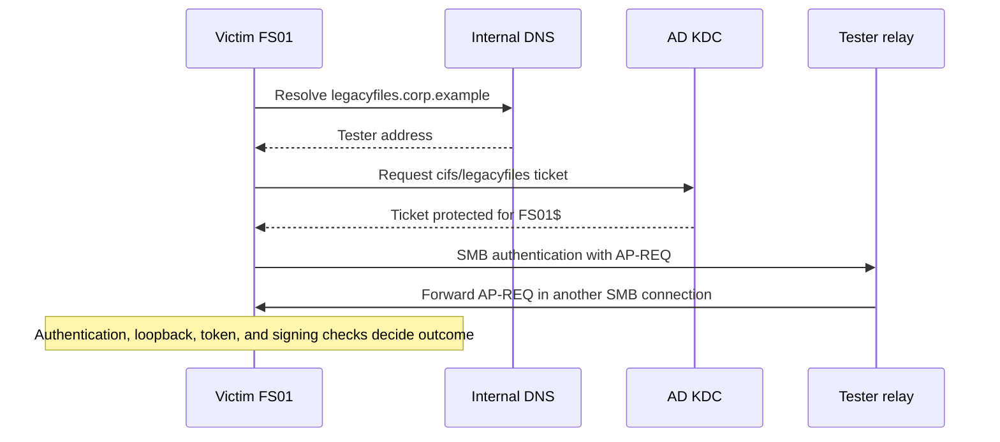

# Ghost SPNs and Kerberos Reflection to SYSTEM over SMB
## CVE-2025-58726: Penetration Testing Analysis and Assessment Framework

**Research date:** October 27, 2026  
**Audience:** Authorized internal penetration testers  
**Scope:** Concepts, mechanism, discovery, exploitability assessment, reporting, remediation, and knowledge checks.

> This Markdown export preserves the substantive analysis from the conversation. Interactive questions have been converted to ordinary multiple-choice questions, and conversation citations have been replaced with portable source links. Example hostnames, addresses, identities, and findings are illustrative. No client environment was tested.

**A ghost SPN exposes a possible authentication path; it does not, by itself, establish exploitability.** The dangerous combination is an SPN owned by the target computer, control over that hostname’s resolution, suitable machine authentication, a vulnerable SMB server, and no effective signing requirement on the receiving SMB connection. Semperis documented this combination as CVE-2025-58726 and reports that Microsoft fixed the remote reflection path in October 2025. [1]

The central distinction is:

> **DNS determines where the connection goes. AD’s SPN ownership determines whose key protects the service ticket. Windows authentication processing determines the resulting token.**

Keep those three decisions separate throughout testing.

## Before Studying: Six Priming Questions

Try answering these before studying. They expose the reasoning gaps this material should close:

1. How can a ticket for `cifs/retired-alias.corp.example` be accepted by `FS01` when the alias resolves to the tester’s IP?
2. Why can reflecting authentication originating as SYSTEM behave differently from authenticating with independently obtained `FS01$` credentials?
3. Can an account create an absent DNS name while being unable to modify an existing name in the same zone?
4. Why might requiring outbound SMB signing fail to provide the protection you expected?
5. What distinguishes an authoritative NXDOMAIN response from an absent A record, a timeout, and an inaccessible server?
6. If the October 2025 fix blocks remote reflection, what additional attacker capability could change the assessment into a local privilege escalation scenario?

## 1. Key Concepts and Definitions

This is the vocabulary needed for this attack path and its assessment, rather than every Kerberos feature.

| Term | Meaning and significance |
|---|---|
| Security principal | An identity to which authentication and permissions apply, such as a user or computer account. |
| Computer account | An AD identity such as `CORP\FS01$`. Its credentials are used by several Windows services for network authentication. |
| SPN | Service Principal Name: a directory identifier associating a service instance with its sign-in account. |
| SPN ownership | The AD object holding a particular `servicePrincipalName` value. This is separate from ownership of the corresponding DNS name. |
| SPN service class | The first component, such as `cifs`, `HOST`, or `HTTP`. It identifies the service category. |
| `CIFS` | The conventional Kerberos service class used for SMB authentication, including modern SMB versions. |
| `HOST` | A service class that can substitute for several built-in service classes through AD’s SPN mappings. |
| `sPNMappings` | Configuration describing service-class equivalences. Relevant when `HOST/alias` supports a request for `cifs/alias`. |
| Ghost SPN | An existing SPN whose hostname does not resolve in the relevant DNS context. A useful discovery label, not a vulnerability verdict. |
| Alias | An additional name for a service or computer. An alias SPN can remain after the DNS name disappears. |
| KDC | Key Distribution Center, normally on a domain controller in AD; issues Kerberos tickets. |
| TGT | Ticket-granting ticket, used to request service tickets. |
| TGS exchange | The request and response through which a client obtains a service ticket. |
| Service ticket | A ticket intended for a service principal; its encrypted portion is protected with the service account’s key. |
| Long-term key | An account key derived from its credentials. Distinct from a connection’s session keys. |
| Session key / subkey | Keys used within an authentication context and subsequent protected communication. Their possession matters for signing. |
| AP-REQ | The Kerberos authentication message presented to an application server. Includes a ticket and an authenticator. |
| Authenticator | Fresh, cryptographically protected client information accompanying a ticket. Helps prevent reuse of captured authentication. |
| SPNEGO / Negotiate | Negotiation of an authentication mechanism, commonly Kerberos or NTLM. “Negotiate” does not prove Kerberos was selected. |
| SSPI | Windows interface through which applications request and accept authentication contexts. |
| LSASS | Windows process hosting important authentication and security functions, including Kerberos processing. |
| Access token | Windows representation of an authenticated security context, including identity, groups, and privileges. |
| LocalSystem / SYSTEM | Highly privileged local identity, commonly shown as `NT AUTHORITY\SYSTEM`. Uses the computer’s credentials on the network. |
| NetworkService | A less privileged local identity that also uses computer credentials on the network. |
| Coercion | Causing a service to initiate outbound authentication, often through an RPC operation. |
| Relay | Forwarding authentication to another service without knowing the credentials. |
| Reflection | Relay back to a service on the originating host. |
| Loopback authentication | Authentication recognized as involving a client and server on the same machine. This recognition is distinct from the TCP source address. |
| AD-integrated DNS / ADIDNS | DNS zones and records stored as AD objects and replicated through AD. |
| `dnsNode` / `dnsRecord` | The directory object representing a DNS name and the attribute containing its resource records. |
| DACL / ACE | Permission list and individual permission entry. Used to assess DNS object creation and modification rights. |
| SACL | Auditing configuration specifying which accesses or changes should generate audit events. |
| Secure dynamic update | Authenticated DNS updating subject to permissions. Authentication does not guarantee that the permissions are appropriately restrictive. |
| NXDOMAIN / NODATA | Respectively, the queried name does not exist, or the name exists without the requested record type. |
| A / AAAA / CNAME | IPv4 address, IPv6 address, and alias records. All can affect where a name ultimately leads. |
| SMB signing | Cryptographic integrity protection for SMB messages using session-associated keys. |
| Signing enabled / required | Supporting signing is different from refusing unsigned communication. |
| Channel binding / EPA | Mechanisms binding authentication to the intended channel or service, relevant when studying relay to other protocols. |
| CMTI | Credential marshaled target information, involved in an earlier name/SPN decoupling technique associated with CVE-2025-33073. |

Microsoft documents SPN ownership and aliasing, the Kerberos standard defines the ticket exchanges, and Windows documents the distinct network behavior of SYSTEM and NetworkService. [2] [3] [4] [5]

## 2. Service Identity and Network Location Are Separate Decisions

An SPN is an authentication identifier stored in AD. It is not a DNS record and does not disappear merely because DNS resolution fails.

Consider this hypothetical directory state:

| Property | Value |
|---|---|
| Computer account | `CORP\FS01$` |
| Current computer hostname | `fs01.corp.example` |
| Additional SPN on that account | `HOST/legacyfiles.corp.example` |
| DNS state of additional name | NXDOMAIN |
| Actual SMB server | `FS01`, using the computer account’s credentials |

The question for Kerberos is effectively: “Which account represents this requested service?” The question for DNS is: “Which network address should receive this connection?” Those answers can come from different administrative state.

If a tester can make `legacyfiles.corp.example` resolve to the tester’s address, **that changes routing without transferring the SPN to the tester’s account**. A ticket issued for a service associated with `FS01$` remains protected for that account.

Why does `HOST` matter? Microsoft lists `cifs` among the built-in service classes for which a computer’s HOST SPN can substitute. Therefore, looking only for literal `CIFS/...` values misses relevant names. An explicit registration elsewhere or nonstandard mappings can complicate that relationship, so preserve ownership information and examine the effective mapping. [6] [7]

**Concrete reasoning:** If the alias SPN instead belongs to an unrelated application account, pointing its DNS name at the tester does not make the resulting ticket decryptable by `FS01`’s SMB service. The account holding the service key is decisive.

## 3. Follow the Authentication Message

In the vulnerable scenario, the target initiates authentication using a name whose SPN maps back to its own account. The tester receives the resulting authentication and forwards it to the target’s SMB service.



The relayed object is the **application authentication exchange**, particularly the AP-REQ. The tester does not need to forge a ticket or recover the target’s password. Nor does receiving an AP-REQ reveal the session key required to originate arbitrary signed SMB messages. Kerberos separates the ticket, authenticator, and keys used for subsequent communication. [3]

A replay cache does not automatically make this impossible. A live relay can deliver the authenticator to the legitimate accepting service for its first acceptance. That differs from repeatedly submitting a previously accepted authenticator.

For evidence collection, distinguish:

- **Ticket request observed:** the KDC was asked for a service ticket.
- **AP-REQ received:** the authentication reached the listener.
- **Authentication accepted:** the destination accepted a security context.
- **Privileged operation completed:** the resulting session had useful authority and satisfied protocol protections.

Each proves something different.

## 4. Why the Result Can Become SYSTEM

SYSTEM and a computer account are related, but they are not interchangeable identities. SYSTEM presents the machine’s credentials to remote services. NetworkService does so too, despite having substantially fewer local privileges. A captured machine-account name alone therefore cannot establish the originating local privilege level. [4] [5]

Synacktiv’s reverse engineering explains the relevant Windows behavior:

1. When SYSTEM or NetworkService creates Kerberos authentication, Windows records information associating an authenticator subkey with the originating logon context.
2. When accepting authentication as its own computer account, Windows can look up that subkey.
3. If the matching context originated as SYSTEM, token construction can produce a SYSTEM identity with local administrative membership.

This explains the privilege increase more precisely than “computer accounts are administrators on themselves.” [8]

**Why this exists:** Windows needs to preserve aspects of local security context when authentication returns to the same machine. Otherwise, treating every local network authentication as an unrelated fresh logon could produce incorrect privilege behavior. Windows also defines local authentication and token restriction structures, although those protocol definitions alone do not document every implementation detail. [9] [10] [11]

**Concrete comparison:**

| Authentication supplied to `FS01` | What you can infer |
|---|---|
| Ordinary authentication using independently obtained `FS01$` credentials | A machine-account authentication; SYSTEM is not automatic. |
| Live reflected authentication generated by a SYSTEM context on `FS01` | Can enter the vulnerable local-context handling path. |
| Reflected machine authentication originating as NetworkService | Does not establish a SYSTEM outcome merely because the account name is `FS01$`. |
| Authentication originating from another computer | A different relay scenario, requiring its own authorization analysis. |

Early RedTeam Pentesting material explicitly described its initial token explanation as a theory. Synacktiv subsequently provided implementation-level analysis. Treat the observed privileged outcome and the explanation’s evidentiary maturity separately. [12]

## 5. DNS Absence and DNS Control Are Separate Findings

A failed lookup is an observation from a particular resolver, client, time, name, and record type. It is not yet proof that the name is available to claim.

| Observation | Interpretation | Assessment consequence |
|---|---|---|
| Authoritative NXDOMAIN | The queried name does not exist in that DNS view. | Strong candidate for further investigation. |
| NOERROR with no A record | Name may exist without IPv4 addressing. | Check AAAA, aliases, and directory state. |
| AAAA exists | IPv6 resolution is available. | An absent A record is insufficient. |
| CNAME points to a nonexistent target | The alias exists, but its chain is broken. | Determine control over the relevant existing objects or target namespace. |
| SERVFAIL | Resolution failed. | Do not classify as absent. |
| Timeout | No usable response arrived. | Treat as unknown. |
| Different answers across resolvers | Views, forwarding, caching, or replication may differ. | Reproduce the target’s actual resolution path. |

NXDOMAIN, NODATA, and negative caching have distinct DNS semantics. Negative answers can remain cached after a record is created, affecting controlled validation. [13]

**Short names deserve special treatment.** `HOST/legacyfiles` does not, by itself, tell you which fully qualified DNS name a particular target will query. Search suffixes and name processing matter. Record the original SPN and the actual QNAME separately; do not silently append your assessment machine’s domain suffix and call that authoritative.

**DNS write rights involve two different questions:**

- **Absent directory node:** Can this identity create the necessary `dnsNode` beneath the authoritative zone?
- **Existing directory node:** Can this identity modify its records, or obtain that ability through ownership or permission changes?

AD requires appropriate child-creation rights on the parent for object creation. Existing object modification has a different access check. Consequently, being unable to overwrite `fs01.corp.example` says little about the ability to create a previously absent alias. [14]

Secure dynamic updates authenticate the updater and check permissions. They do not imply that ordinary authenticated users are forbidden from creating arbitrary unused names. Microsoft describes the permission checks, while the original ghost-SPN research identifies permissive record registration as a prerequisite. [15] [1]

Also inspect directory state behind apparently absent DNS names. A logically deleted DNS name can retain a `dnsNode` with `dNSTombstoned=TRUE`. DNS absence therefore does not prove directory-object absence or predictable claimability. [16]

**Concrete example:** If `legacyfiles` has an existing protected node containing only a TXT record, “no address record” does not imply that a standard user can add an A record. Evaluate the node’s actual permissions.

## 6. Signing at the Receiving SMB Server

SMB signing uses session-associated keys to protect messages. A relay operator may forward authentication without possessing the keys needed to generate valid subsequent requests. Requiring signatures at the destination prevents that operator from turning accepted authentication into arbitrary unsigned SMB operations. [17]

There are two connections to consider:

| Connection | Client | Server | Assessment focus |
|---|---|---|---|---|
| Outbound authentication | Victim | Tester listener | Whether the required authentication is emitted and reaches the listener |
| Reflected authentication | Tester relay | Victim SMB server | Whether the victim requires signing and rejects unusable reflected sessions |

**The victim’s inbound SMB signing requirement is the decisive signing check for this path.** Requiring signing only on its outbound client connections is not an equivalent protection. The original reflective Kerberos research specifically demonstrated that client-side signing preference did not prevent its attack. [18]

This happens because the initial authentication token can be available before the client completes a usable, protected application session with the listener. Capturing that token does not require successfully conducting arbitrary signed file operations on the first connection.

Do not confuse these results:

- **“Signing supported/enabled”** means the implementation can sign.
- **“Signing required”** means signatures are mandatory.
- **“This legitimate connection is signed”** describes one connection and does not prove that unsigned alternatives are refused.

The protocol distinguishes enabled and required signing flags. [19]

Defaults are also edition- and direction-specific. Microsoft’s dedicated signing documentation lists Windows 11 24H2 Pro, Enterprise, and Education as requiring inbound and outbound signing, Server 2025 as requiring outbound signing only, and Windows 11 24H2 Home as requiring neither. Measure the actual endpoint configuration. [17]

## 7. Patch State and Coercion

The ghost-SPN method avoided reliance on the earlier CMTI technique: it used an already registered alias associated with the target. Thus, installing the June 2025 client-side fix did not establish protection against this different path. [20]

For CVE-2025-58726, the important server-side change is that SMB validates the connection’s source address when authentication is recognized as local. A remotely arriving reflected authentication is rejected even though the Kerberos context indicates loopback. Later research confirms the check in `srv2.sys`. [21]

That yields a useful distinction:

| Condition | Interpretation |
|---|---|
| Ghost SPN, claimable name, optional signing, vulnerable SMB server | Candidate for the historical remote reflection path |
| Same conditions, effective October 2025 server fix | Original remote reflection path should be rejected |
| Fixed server and required inbound signing | Independent protections against this SMB path |
| Ghost SPN but no demonstrated authentication trigger | Incomplete exploitation case |
| Authentication received but wrong service, identity, or context | Does not establish the required primitive |

A coercion interface must actually be reachable, permit the operation under the test account, and cause suitable authentication. Merely naming PrinterBug or PetitPotam in a report proves none of those conditions.

**Current context, checked October 27, 2026:** Synacktiv published a subsequent local forwarding variant, CVE-2026-26128, and reports a March 2026 fix enforcing SMB signing for local connections. This requires additional local capability and is a separate assessment from the original remote attack. Recommend current cumulative updates, not merely the October 2025 minimum. Do not describe a local forwarding result as proof that the original remote fix is absent. [21]

## 8. Common Misconceptions

| Misconception | Why it sounds plausible | Correct understanding |
|---|---|---|
| “Every unresolved SPN is exploitable.” | DNS absence is easy to scan and the attack name emphasizes ghosts. | Ownership, claimability, authentication context, connectivity, server protections, and signing all matter. |
| “Creating the DNS record creates or changes the SPN.” | Both contain the same hostname. | DNS and AD service identity are separate state. The dangerous SPN already belongs to the target. |
| “A computer account authenticating to itself always becomes SYSTEM.” | SYSTEM uses machine credentials and demonstrations show SYSTEM execution. | The local originating context and Windows token processing explain the exceptional outcome. |
| “Secure updates or enabled signing already block this.” | Both sound like security guarantees. | Secure updates still depend on authorization; signing must be required on the relevant receiving connection. |
| “Kerberos mutual authentication makes relay impossible.” | Kerberos verifies cryptographic identities. | Authentication does not automatically give every application sufficient endpoint binding, message integrity enforcement, or reflection protection. |

The portable lesson is to avoid substituting a feature name for a verified security property.

## 9. Portable Rules and Frameworks

These are practical names for this assessment procedure, not claims that they are published industry standards.

### The Three Decisions Rule

For every candidate, write three separate answers:

1. **Routing:** Where does the target connect?
2. **Identity:** Which AD account owns the requested service identity?
3. **Authorization:** Which token and operations result at the receiving service?

If your notes merge these into “the hostname is owned by the target,” the analysis is incomplete.

### The Six-Gate Test

Evaluate each gate as **Yes, No, or Unknown**.

| Gate | Required question |
|---|---|
| Identity | Does the effective CIFS service identity map to the intended target’s SMB service credentials? |
| Routing | Can the test identity make the target resolve the required name to a controlled listener? |
| Trigger | Can it induce suitable Kerberos authentication from the required privileged context? |
| Reachability | Can the target reach the listener, and can the relay reach target SMB? |
| Reflection acceptance | Does the target’s effective implementation permit the reflected context? |
| Session usability | Can the resulting SMB session perform the intended operation despite signing or other protection? |

A verified **No** breaks this exact path. An **Unknown** is missing evidence, not a successful gate.

### The Evidence Ladder

1. Unresolved service name observed.
2. Relevant ownership confirmed.
3. DNS control established.
4. Suitable authentication received.
5. Reflection accepted.
6. Privileged operation demonstrated.

Report the highest level actually reached.

### The One-Control Differential

In a lab, change one variable between runs: signing, patch state, DNS claimability, or originating context. A success/failure pair isolates causality more effectively than several successful demonstrations with unrelated configurations.

### The Exact-Identity Rule

A DNS update performed using an administrative account does not prove the low-privilege tester account could perform it. Record the identity used for every material action.

## 10. Applying It: Easiest First

### Option A: Run the Discoverer’s Inventory Script

Andrea Pierini publishes [TestComputerSpnDNS](https://github.com/decoder-it/TestComputerSpnDNS). After reviewing the downloaded script:

```powershell
Import-Module ActiveDirectory
. .\TestComputerSpnDNS.ps1

Test-ComputerSpnDns `
    -SearchBase 'OU=Servers,DC=corp,DC=example'
```

**What this proves:** You can identify computer-account SPNs referencing names that fail resolution from the assessment environment.

**What it does not prove:** Exploitability. The version inspected treats resolution exceptions as unresolved results, filters some names, and by default checks resolution of the computer itself. Use it for candidate generation and preserve those limitations in your notes. [22]

### Option B: Produce an Inventory That Preserves Ownership

This read-only PowerShell example inventories conventional hostname-bearing SPNs in one domain. It retains all service classes so you can investigate adjacent cases later.

```powershell
Import-Module ActiveDirectory

$rows = Get-ADObject `
    -SearchBase 'DC=corp,DC=example' `
    -LDAPFilter '(servicePrincipalName=*)' `
    -Properties servicePrincipalName,sAMAccountName,dNSHostName |
    ForEach-Object {
        $owner = $_

        foreach ($spn in $owner.servicePrincipalName) {
            if ($spn -match '^(?<Class>[^/]+)/(?<Host>[^/:]+)(?::(?<Port>\d+))?(?:/.*)?$') {
                [pscustomobject]@{
                    OwnerDN      = $owner.DistinguishedName
                    OwnerClass   = $owner.ObjectClass
                    Account      = $owner.sAMAccountName
                    ComputerDNS  = $owner.dNSHostName
                    SPN          = $spn
                    ServiceClass = $Matches.Class
                    Hostname     = $Matches.Host
                    Port         = $Matches.Port
                }
            }
        }
    }

$rows | Export-Csv .\spn-inventory.csv -NoTypeInformation

$rows | Where-Object {
    $_.OwnerClass -eq 'computer' -and
    $_.ServiceClass -in @('HOST', 'CIFS')
} | Format-Table Account, ServiceClass, Hostname
```

Run separately against each relevant domain. This parser is for conventional hostname forms; retain the original directory export for unusual, IP-literal, or opaque names.

**What this proves:** You understand that the useful unit is **SPN + owning account + name**, rather than a deduplicated hostname list.

For individual ownership checks:

```powershell
setspn -F -Q "HOST/legacyfiles.corp.example"
setspn -F -Q "CIFS/legacyfiles.corp.example"
```

A missing explicit CIFS registration does not invalidate a relevant HOST mapping. Microsoft documents both forest queries and HOST substitution. [6]

### Option C: Validate DNS State from the Relevant View

On Windows:

```powershell
Resolve-DnsName `
    -Name 'legacyfiles.corp.example.' `
    -Type A `
    -Server '10.0.0.10' `
    -DnsOnly -NoHostsFile

Resolve-DnsName `
    -Name 'legacyfiles.corp.example.' `
    -Type AAAA `
    -Server '10.0.0.10' `
    -DnsOnly -NoHostsFile
```

These options select the DNS server, avoid hosts-file answers, and prevent LLMNR/NetBIOS resolution from obscuring the DNS check. [23]

For raw DNS status and authoritative-answer inspection:

```bash
dig @10.0.0.10 legacyfiles.corp.example. A +norecurse
dig @10.0.0.10 legacyfiles.corp.example. AAAA +norecurse
```

Use servers authoritative for the actual zone; repeat against the resolver path used by the target. Save responses, timestamps, and CNAME chains. A nonrecursive query to an unrelated resolver is not an authoritative absence check.

**What this proves:** You can distinguish absent addressing, absent names, and failed resolution.

### Option D: Assess the Exact DNS Authorization

Locate the authoritative zone and its directory storage. A common example is:

```text
DC=corp.example,CN=MicrosoftDNS,
DC=DomainDnsZones,DC=corp,DC=example
```

Do not assume that location: zones may use other directory partitions.

For a known zone DN:

```powershell
$zoneDN = 'DC=corp.example,CN=MicrosoftDNS,DC=DomainDnsZones,DC=corp,DC=example'

Get-Acl ("AD:\" + $zoneDN) |
    Format-List Owner,Access

Get-ADObject `
    -SearchBase $zoneDN `
    -SearchScope OneLevel `
    -LDAPFilter '(&(objectClass=dnsNode)(name=legacyfiles))' `
    -Properties dnsRecord,dNSTombstoned
```

Interpret the permissions against the test identity’s groups, inheritance, object-type restrictions, and any deny entries. **An ACL listing is supporting evidence, not a complete effective-access calculation.**

If validation includes DNS writes, test creation of a unique, designated name using the actual low-privilege identity. Verify resolution from the relevant DNS view and remove the test record afterward. A successful random-name test establishes general creation capability; inspect the exact candidate’s state separately.

**What this proves:** You understand the difference between zone child creation and modification of an existing name.

### Option E: Measure the Receiving SMB Server

```bash
nmap -Pn -p445 --script smb2-security-mode 10.0.0.25
```

The Nmap script negotiates supported SMB2/SMB3 dialects and reports signing configuration. “Message signing enabled but not required” is the important permissive result. This is a signing check, not a CVE-2025-58726 detector. [24]

With host-side access, obtain both directions:

```powershell
Get-SmbServerConfiguration |
    Select-Object RequireSecuritySignature

Get-SmbClientConfiguration |
    Select-Object RequireSecuritySignature
```

Collect OS build and installed cumulative-update evidence separately. A signing scan cannot establish patch state.

**What this proves:** You can identify the receiving security boundary and avoid inferring server protection from client settings.

### Option F: Reproduce the Chain in a Controlled Lab

Use a domain controller, a target member server, and a tester host. Arrange a documented alias SPN on the target and an initially absent DNS name. Compare these cases:

| Case | Expected learning outcome |
|---|---|
| Vulnerable target, optional inbound signing, claimable alias, suitable trigger | Establish the complete historical chain. |
| Same setup, required inbound signing | Show that authentication acquisition and usable SMB access are different milestones. |
| Same setup, effective October 2025 server fix | Observe rejection of remotely reflected local authentication. |
| Alias SPN associated with a different account | Demonstrate the importance of the correct service key. |
| Same network identity, different originating local context | Examine why `TARGET$` alone does not prove SYSTEM. |
| Current cumulative updates | Establish the contemporary baseline independently of the historical reproduction. |

Use the original research’s Kerberos-capable tooling and record its version and negotiation behavior. An NTLM capture or “coercion successful” message is insufficient proof of Kerberos reflection.

For a privileged proof, prefer an agreed benign operation with captured identity and timestamp. Review execution tooling beforehand: published demonstrations can change service state while retrieving command output. [12]

## 11. Build a Reportable Evidence Record

Use one row per candidate with at least:

```text
SPN and owning DN
Computer account and current target address
Original hostname and actual queried name
Resolver, DNS view, response status, record types, timestamp
Existing dnsNode / tombstone state
Test identity and DNS-control evidence
Inbound SMB signing requirement
OS build and effective patch evidence
Authentication mechanism and originating context evidence
Reflection result and privileged-operation result
Validation limitations and cleanup confirmation
```

Keep the finding’s title aligned with the evidence:

| Evidence obtained | Suitable characterization |
|---|---|
| Resolution failure only | Unresolved service names require review |
| Ownership and DNS claimability established | Claimable service aliases expose authentication redirection |
| Full configuration chain established, execution not attempted | Conditions supporting Kerberos reflection identified |
| Live reflection and privileged operation demonstrated | Kerberos reflection enables SYSTEM access over SMB |

Do not attach the CVE as a confirmed vulnerability solely because ghost SPNs and optional signing coexist.

### Example Finding Draft: Confirmed Case

Replace every bracketed value with observed evidence.

> **Kerberos reflection through a claimable SPN alias enabled SYSTEM access over SMB**
>
> The computer account `[DOMAIN\TARGET$]` retained `[HOST/CIFS alias SPN]`, while the corresponding hostname had no usable DNS resolution in `[tested DNS view]`. The low-privilege account `[test identity]` could register that name to a controlled endpoint.
>
> The assessment induced Kerberos authentication from `[target service/context]`, received authentication for the alias, and reflected it to `[target]:445`. The target accepted the reflected authentication without requiring SMB signing. The resulting session permitted `[benign privileged operation]`; `[identity evidence]` confirmed execution as `NT AUTHORITY\SYSTEM`.
>
> This allowed a low-privilege domain user to obtain administrative control of the affected host without recovering its password. Additional impact depends on the host’s role, privileges, and accessible resources. The observed behavior is consistent with CVE-2025-58726.
>
> Apply current supported Windows cumulative updates containing the applicable SMB reflection fixes. Require inbound SMB signing on affected systems and deploy signing requirements across the domain. Remove obsolete SPNs after confirming service dependencies, restrict unnecessary DNS creation and modification rights, and reduce exposed authentication-coercion interfaces.
>
> Validation evidence: `[SPN ownership, DNS responses, update identity, signing negotiation, patch evidence, authentication capture, privileged-operation output, and timestamps]`.
>
> Retest by verifying that remote reflection is rejected, unsigned SMB sessions are refused, obsolete aliases are removed or securely managed, and the original low-privilege identity cannot reclaim the relevant names.

For an unexploited case, replace the acceptance and execution statements with the verified conditions and explicitly state that reflection or privilege escalation was not demonstrated.

## 12. Remediation

| Priority | Remediation | Verification |
|---|---|---|
| Immediate | Install current supported cumulative updates containing the relevant SMB fixes; complete required restarts. | Match exact product/build against applicable vendor updates and verify effective deployment. |
| Immediate | Require inbound SMB signing. | Confirm host configuration and independently inspect remote negotiation. |
| Broad hardening | Require outbound signing as well. | Verify client configuration; retain the separate inbound check. |
| Identity hygiene | Remove obsolete SPNs; correct legitimate service registrations. | Reinventory ownership and validate application authentication. |
| DNS authorization | Restrict unnecessary zone child creation and existing-node modification. | Retest with the original low-privilege identity while preserving required DHCP/client registration. |
| Exposure reduction | Restrict unnecessary outbound SMB and incoming SMB/RPC paths; disable unneeded coercible services. | Validate permitted business flows and the previously identified authentication path. |
| Lifecycle controls | Coordinate computer renames, service retirement, DNS deletion, and SPN cleanup. | Reconcile directory identities with DNS and service ownership regularly. |

For signing enforcement:

```powershell
Set-SmbServerConfiguration -RequireSecuritySignature $true -Force
Set-SmbClientConfiguration -RequireSecuritySignature $true -Force
```

The first command addresses the receiving SMB service. Use managed policy for sustained deployment. Microsoft documents both settings. [17]

Do not blindly restore every missing DNS name. Determine whether the service remains legitimate, then either provision its name securely or remove the obsolete authentication identity. DNS scavenging removes stale DNS records; it is not SPN cleanup. [25]

## 13. Detection

A useful detection hypothesis is:

> A previously unresolved name associated with a computer account becomes resolvable to an unusual address, followed by authentication traffic involving that computer and a reflected connection to its SMB service.

Relevant telemetry includes:

- DNS record creation and changes, including updater identity where available.
- AD object creation event **5137** for relevant DNS objects.
- AD modification event **5136** for `dnsRecord`, `dNSTombstoned`, and separately `servicePrincipalName`.
- KDC event **4769** for service ticket requests.
- Network or endpoint evidence of outbound authentication followed by a connection back to the originating host.

Directory change events require appropriate audit policy and SACLs. Absence of those events does not prove absence of a change. [26] [27]

**A subtle logging limitation:** Event 4769’s Service Name identifies the service account or computer, so do not assume it exposes the exact requested alias SPN. Use network Kerberos metadata or suitable additional telemetry to identify the alias. Also, the attack can reuse an existing SPN without modifying `servicePrincipalName`. [28]

## 14. Connections and Further Study

| Connection | Shared idea | What differs |
|---|---|---|
| Dangling DNS and subdomain takeover | An abandoned name can become controllable. | Here, an AD authentication identity remains attached to the name. |
| NTLM relay | Forward authentication without knowing credentials. | Kerberos adds service-key and SPN constraints; NTLM-specific mitigations are not automatically equivalent. |
| Kerberoasting | SPNs lead to service tickets. | Roasting targets offline password recovery; this reflection path depends on live authentication and service behavior. |
| Ordinary machine-account relay | Machine authentication can cross trust boundaries. | SYSTEM reflection depends on returning to the originating host and its local context handling. |
| AD CS or management-service relay | Application protections determine whether authentication is usable. | SMB signing does not secure HTTP endpoints; assess their binding and authorization separately. |
| Permission graphs | A chain can combine several individually ordinary permissions. | Your useful graph includes DNS control and network paths alongside directory rights. |

For further study, prioritize **SSPI context creation and acceptance**, **Kerberos authenticators and subkeys**, **AD SPN resolution**, **ADIDNS authorization**, and **SMB session establishment**. Those topics explain the mechanism well enough to assess new variants without relying on a particular tool’s success message.

The original researcher’s [Kerberos relay overview][29] is useful for adjacent service considerations. Treat each destination protocol’s integrity and channel-binding controls independently. [29]

## 15. Questions That Test Real Understanding

The first three questions have exactly one defensible answer each. Correct answers and explanations follow each question.

### Recall

**What determines the account key protecting a Kerberos service ticket in the ordinary AD service-ticket flow?**

A. The account associated with the destination IP address.  
B. The AD account resolved for the requested service principal.  
C. The account that created the hostname’s DNS record.  
D. The account running the relay listener.

**Correct answer: B.** The KDC resolves the service principal to its account and uses the applicable service key.

Why the distractors fail:

- **A:** An IP address routes traffic; it does not select the AD service account key.
- **C:** DNS updater identity does not transfer ownership of an existing SPN.
- **D:** Receiving an authentication message does not make the listener its cryptographic service principal.

### Comprehension

**Why does observing TARGET$ authentication fail to prove that reflection will yield SYSTEM?**

A. Computer accounts cannot participate in Kerberos authentication.  
B. Every TARGET$ authentication already has SYSTEM privileges.  
C. Different local service contexts can use the same machine credentials.  
D. DNS record ownership determines the resulting Windows token.

**Correct answer: C.** SYSTEM and NetworkService can present machine credentials while having different local authority.

Why the distractors fail:

- **A:** Computer accounts can authenticate using Kerberos.
- **B:** Ordinary machine-account authentication does not automatically grant SYSTEM.
- **D:** DNS ownership controls authorization over name records, not Windows token construction.

### Application

**A target has a claimable ghost alias, emits suitable Kerberos authentication, requires outbound signing, and allows optional inbound signing. Its patch state is unknown. What conclusion is justified?**

A. The target is protected because outbound signing is required.  
B. SYSTEM compromise is confirmed because authentication was emitted.  
C. DNS registration proves that the target’s SPN changed ownership.  
D. The path remains a candidate pending patch and session validation.

**Correct answer: D.** The receiving server’s effective reflection protection and resulting session usability remain unverified.

Why the distractors fail:

- **A:** Outbound client policy does not establish signing enforcement on the receiving SMB connection.
- **B:** Receiving authentication does not prove reflection acceptance or a privileged operation.
- **C:** Creating a DNS record does not change which AD account holds the SPN.

### Challenge — Open Response

You find `HOST/archive.corp.example` on `FS01$`. One resolver returns NXDOMAIN, another returns a CNAME to an IPv6-only endpoint. Your account can create unrelated names but cannot modify an existing `archive` DNS node. Inbound signing is optional, the October 2025 update is installed, and you have a low-privilege shell on `FS01`.

Explain:

- Which statements about “ghost” status and DNS control are currently defensible?
- Which gates are No, Yes, or Unknown?
- How would you distinguish the original remote CVE from a later local reflection scenario?
- What minimum additional evidence would justify raising, lowering, or splitting the finding?
- Which single-control experiments would best explain the outcome?

## 16. Sources and Confidence

| Topic | Confidence | Basis and limitation |
|---|---|---|
| Ghost-SPN prerequisites and published SYSTEM outcome | High | Original Semperis research. [1] |
| SPN ownership and HOST/CIFS substitution | High | Microsoft SPN and `setspn` documentation. [2] [6] |
| SYSTEM token mechanism | High for the analyzed implementations | Synacktiv’s reverse engineering; internal function names and details may vary by build. [8] |
| DNS absence and authorization distinctions | High | DNS standards and Microsoft AD/DNS documentation; exact effective rights remain environment-specific. [13] [14] [15] |
| Inbound signing’s importance | High | Original research, SMB protocol definitions, and Microsoft signing documentation. [17] [18] [19] |
| October 2025 remote-path mitigation | High | Independent researcher patch analysis agrees on server-side local-address validation. [1] [21] |
| March 2026 local-path follow-up | High as published research | Synacktiv documents CVE-2026-26128 and its fix; assess it separately from remote exploitation. [21] |
| Exact applicable KB and fixed build for a client asset | Must verify per asset | The MSRC advisory required JavaScript and its per-product update table was not readable during the research. No universal KB is asserted. [30] |
| Exploitability in your assessment | Unestablished until measured | No client environment was tested for this response. The inventory commands and decision procedures are assessment guidance. |

The most valuable result to produce is a candidate register that preserves **ownership, resolution view, effective DNS control, authentication context, inbound signing, patch state, and demonstrated impact**. That gives you a defensible finding even when the final answer is that one verified control breaks the chain.

### Source Register

1. [Semperis — Exploiting Ghost SPNs and Kerberos Reflection for SMB Server Privilege Elevation][1]. Original ghost-SPN disclosure and mitigation discussion.
2. [Microsoft — Service principal names][2].
3. [RFC 4120 — The Kerberos Network Authentication Service (V5)][3].
4. [Microsoft — LocalSystem Account][4].
5. [Microsoft — NetworkService Account][5].
6. [Microsoft — Setspn][6].
7. [Microsoft MS-DRSR — MapSPN][7].
8. [Synacktiv — NTLM reflection is dead, long live NTLM reflection! An in-depth analysis of CVE-2025-33073][8]. Includes Kerberos token-construction analysis.
9. [Microsoft MS-KILE — KERB_AUTH_DATA_LOOPBACK][9].
10. [Microsoft MS-KILE — KERB-AD-RESTRICTION-ENTRY][10].
11. [James Forshaw — Bypassing UAC in the most Complex Way Possible!][11].
12. [RedTeam Pentesting — A Look in the Mirror: The Reflective Kerberos Relay Attack][12].
13. [RFC 2308 — Negative Caching of DNS Queries][13].
14. [Microsoft — Access Control and Object Creation][14].
15. [Microsoft — Dynamic DNS Update in Windows and Windows Server][15].
16. [Microsoft MS-ADA1 — Attribute dNSTombstoned][16].
17. [Microsoft — Control SMB signing behavior][17].
18. [RedTeam Pentesting — Reflective Kerberos Relay Attack, technical whitepaper (PDF)][18].
19. [Microsoft MS-SMB2 — SMB2 SESSION_SETUP Request][19].
20. [Andrea Pierini — Reflecting Your Authentication: When Windows Ends Up Talking to Itself][20].
21. [Synacktiv — Bypassing Windows authentication reflection mitigations for SYSTEM shells, Part 2][21]. Published April 30, 2026; includes CVE-2025-58726 patch analysis and CVE-2026-26128.
22. [Andrea Pierini / decoder-it — TestComputerSpnDNS.ps1][22].
23. [Microsoft — Resolve-DnsName][23].
24. [Nmap — smb2-security-mode NSE script][24].
25. [Microsoft — DNS aging and scavenging][25].
26. [Microsoft — Event 5137: A directory service object was created][26].
27. [Microsoft — Event 5136: A directory service object was modified][27].
28. [Microsoft — Event 4769: A Kerberos service ticket was requested][28].
29. [Andrea Pierini — From NTLM relay to Kerberos relay: Everything you need to know][29].
30. [Microsoft Security Response Center — CVE-2025-58726][30]. Use the per-product update information when verifying a specific asset.

[1]: https://www.semperis.com/blog/exploiting-ghost-spns-and-kerberos-reflection-for-smb-server-privilege-elevation/
[2]: https://learn.microsoft.com/en-us/windows/win32/ad/service-principal-names
[3]: https://www.rfc-editor.org/rfc/rfc4120.html
[4]: https://learn.microsoft.com/en-us/windows/win32/services/localsystem-account
[5]: https://learn.microsoft.com/en-us/windows/win32/services/networkservice-account
[6]: https://learn.microsoft.com/en-us/windows-server/administration/windows-commands/setspn
[7]: https://learn.microsoft.com/en-us/openspecs/windows_protocols/ms-drsr/77063286-8864-438e-9a71-74e1efac2a9e
[8]: https://www.synacktiv.com/en/publications/ntlm-reflection-is-dead-long-live-ntlm-reflection-an-in-depth-analysis-of-cve-2025
[9]: https://learn.microsoft.com/en-us/openspecs/windows_protocols/ms-kile/2a01b297-c47f-4547-9268-cf589aedd063
[10]: https://learn.microsoft.com/en-us/openspecs/windows_protocols/ms-kile/1aeca7fb-d6b4-4402-8fa4-6ec3e955c16e
[11]: https://www.tiraniddo.dev/2022/03/bypassing-uac-in-most-complex-way.html
[12]: https://blog.redteam-pentesting.de/2025/reflective-kerberos-relay-attack/
[13]: https://www.rfc-editor.org/rfc/rfc2308.html
[14]: https://learn.microsoft.com/en-us/windows/win32/ad/access-control-and-object-creation
[15]: https://learn.microsoft.com/en-us/windows-server/networking/dns/dynamic-update
[16]: https://learn.microsoft.com/en-us/openspecs/windows_protocols/ms-ada1/4a2b620d-622b-4064-9597-d258d4a2f080
[17]: https://learn.microsoft.com/en-us/windows-server/storage/file-server/smb-signing
[18]: https://www.redteam-pentesting.de/publications/2025-06-11-Reflective-Kerberos-Relay-Attack_RedTeam-Pentesting.pdf
[19]: https://learn.microsoft.com/en-us/openspecs/windows_protocols/ms-smb2/5a3c2c28-d6b0-48ed-b917-a86b2ca4575f
[20]: https://decoder.cloud/2025/11/24/reflecting-your-authentication-when-windows-ends-up-talking-to-itself/
[21]: https://www.synacktiv.com/en/publications/bypassing-windows-authentication-reflection-mitigations-for-system-shells-part
[22]: https://github.com/decoder-it/TestComputerSpnDNS/blob/main/TestComputerSpnDNS.ps1
[23]: https://learn.microsoft.com/en-us/powershell/module/dnsclient/resolve-dnsname?view=windowsserver2025-ps
[24]: https://nmap.org/nsedoc/scripts/smb2-security-mode.html
[25]: https://learn.microsoft.com/en-us/windows-server/networking/dns/aging-scavenging
[26]: https://learn.microsoft.com/en-us/previous-versions/windows/it-pro/windows-10/security/threat-protection/auditing/event-5137
[27]: https://learn.microsoft.com/en-us/previous-versions/windows/it-pro/windows-10/security/threat-protection/auditing/event-5136
[28]: https://learn.microsoft.com/en-us/previous-versions/windows/it-pro/windows-10/security/threat-protection/auditing/event-4769
[29]: https://decoder.cloud/2025/04/24/from-ntlm-relay-to-kerberos-relay-everything-you-need-to-know/
[30]: https://msrc.microsoft.com/update-guide/vulnerability/CVE-2025-58726

